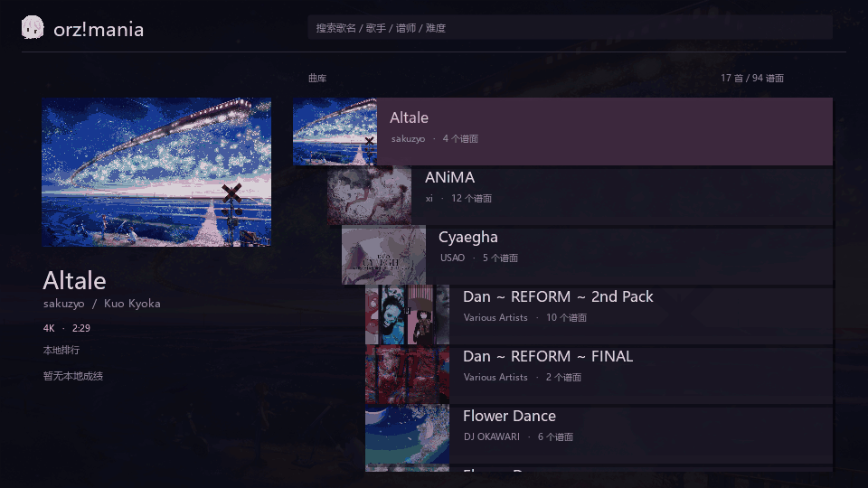
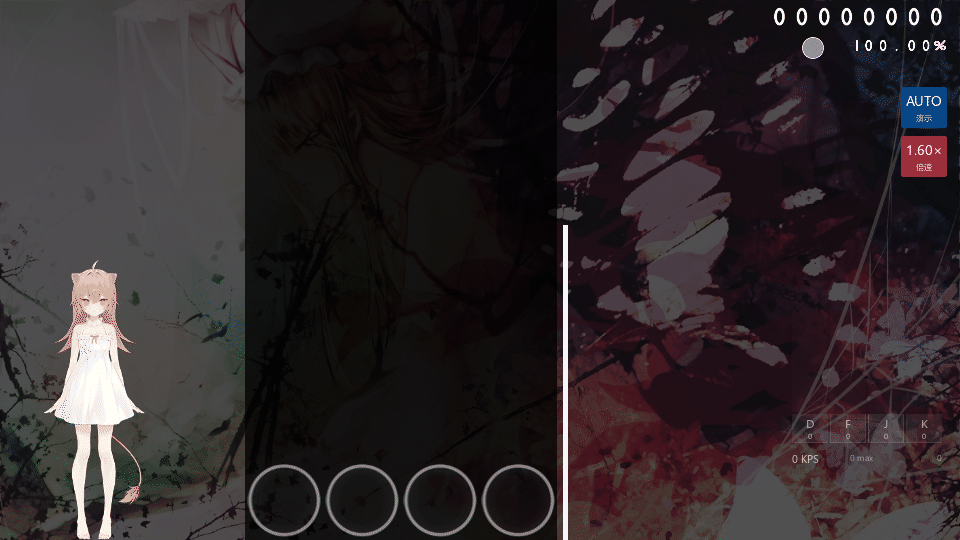
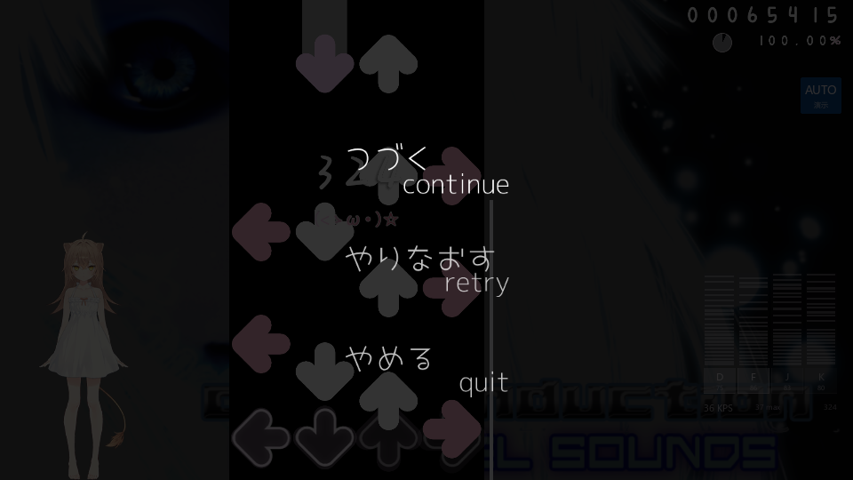
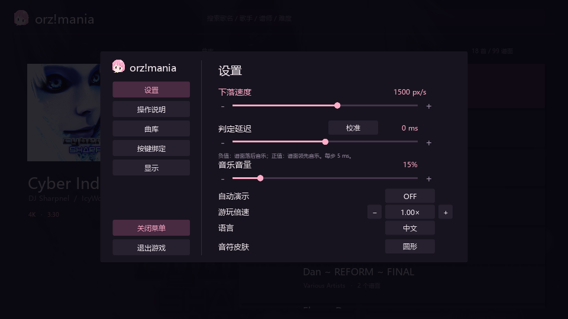
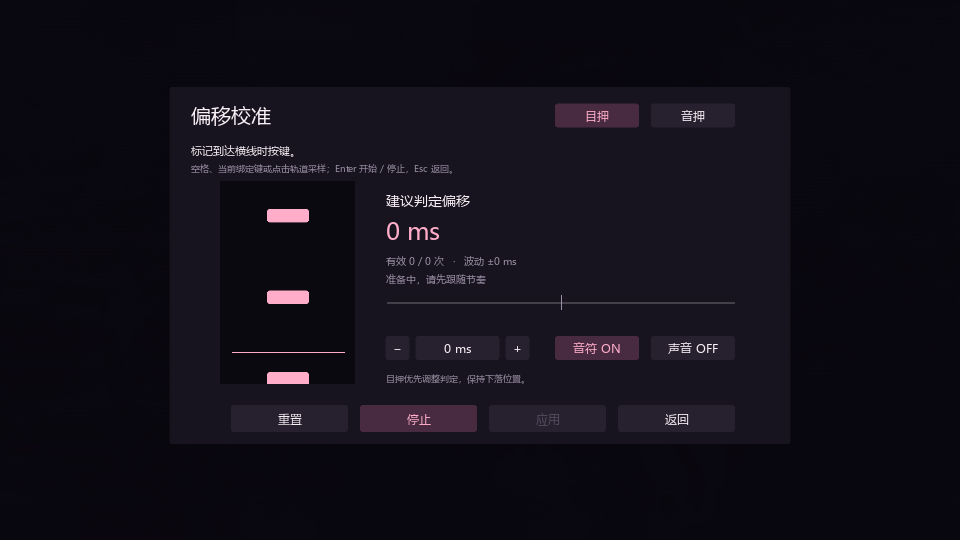
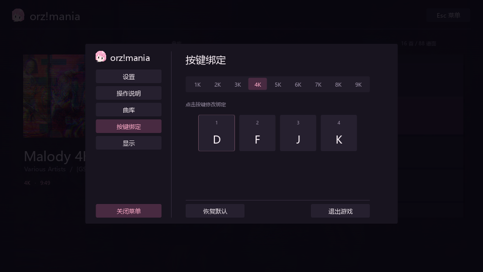
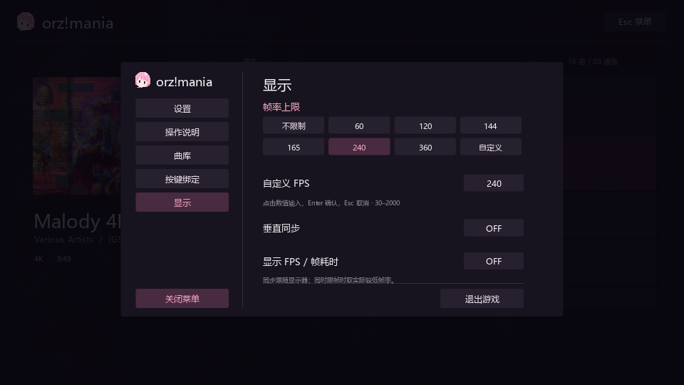

# orz!mania

<p align="center">
  
</p>

<p align="center">
  基于仓颉与 SDL3 的轻量化多轨下落式音游。
</p>

<p align="center">
  
  
  
  
</p>

<p align="center">
  <a href="#实际画面">实际画面</a> · <a href="#自定义倍速练习">倍速练习</a> · <a href="#轻量化设计">轻量化设计</a> · <a href="#运行">运行</a> · <a href="#导入与操作">导入与操作</a> · <a href="#判定与计分">判定与计分</a> · <a href="#设置">设置</a> · <a href="#开发与验证">开发与验证</a>
</p>

## 实际画面

**游玩片段 · Malody 4K Extra Dan v3 (Pack 2) / Ex-Final v3**

原生实时录制，曲目18–30秒片段，4K / 1500 px/s / 1.00×，自动演示。


**选曲与滚动**

歌名字典序、抽屉收纳、平滑滚动与搜索；支持歌名、歌手、谱师和难度，空格分隔多关键词。同音频谱面切换保持试听连续。



## 自定义倍速练习

支持**运行时自定义倍速**：**0.50×–2.00×**，步进 **0.05×**，音乐与谱面同步变化，无需修改或重新导出文件。音高随速度变化，非原速 Mod 不计入本地排行。以下均为游戏内实时变速后的自动演示。

**低倍速 · EXF / 0.90×**

将同一18–30秒高难段放慢，便于拆解排键、建立手感，再逐步提高速度。


**高倍速 · PUPA / Another / 1.60×**

从曲目开头录制约10秒。适合对已熟练或较低难度谱面强化训练，挑战速度极限。



## 轻量化设计

- **原生绘制**：仓颉 + SDL3，支持 1K–9K、长按与自定义键位。
- **按需加载**：只绘制可见条目，图片缓存有界，音乐使用压缩播放。
- **异步处理**：图片与试听加载避开绘制线程，复用素材和绘制缓冲。
- **自由调节**：倍速练习、目押校准、背景可见度、帧率与中英文切换。
- **本地成绩**：按谱面保存最佳20条手动完赛记录，选曲查看历史榜，游玩时实时比较排名。

**运行开销实测（2026-11-05）**

Intel i7-13700H（20逻辑核）/ Windows / Direct3D11，2560×1440、240 FPS上限、VSync关闭。EXF密集段（13,447音符）从1:49开始自动演示，隐藏排行榜，保留音乐和按键轨迹；每档独立进程，预热2秒、采样8秒。

| 倍率 | 渲染 FPS | 平均 CPU | 平均私有内存 | 帧内耗时 P95 |
| --- | ---: | ---: | ---: | ---: |
| 0.50× | 238.81 | 1.20% | 142.2 MiB | 0.68 ms |
| 1.00× | 238.75 | 1.41% | 141.0 MiB | 0.81 ms |
| 2.00× | 238.56 | 1.43% | 142.6 MiB | 1.01 ms |

CPU按整机20逻辑核归一化；平均驻留内存约116–117 MiB。私有内存包含运行时与原生库，不等同于仓颉堆或GPU显存；帧内耗时不含限帧等待，FPS为渲染循环统计。以上为本机短时采样，不作为所有设备或曲目的开销上限。

复测（需导入EXF）：`./tools/benchmark.ps1 -Label local -RateTest -Rate 100 -Size 1440p`；`-Rate 50 / 200` 对应低 / 高倍速。

## 运行

需要 **Windows x64** 和已配置环境的 **仓颉 SDK 1.0.5**。SDL 依赖随仓库提供。

```powershell
git clone https://github.com/Azar233/orz-mania.git
cd orz-mania
cjpm run
```

也可运行 `run.cmd`。首次启动后在 **Esc → 曲库** 导入歌曲，选择谱面，按 Enter 或双击开始。

## 导入与操作

支持 `.osz`、`.osu` 和歌曲目录，可通过菜单或拖放导入。歌曲保存在本地 `Songs/`，仓库不附带曲目。

| 操作 | 用途 |
| --- | --- |
| ↑ / ↓、滚轮 | 浏览歌曲与展开的谱面 |
| 点击歌曲、← / → | 展开或收起同曲谱面 |
| Enter / 双击谱面 | 开始游玩 |
| D F J K | 默认 4K 按键，可重新绑定 |
| Enter（长前奏期间） | 跳至首个音符前约两秒 |
| Esc（游玩中） | 暂停；再次按 Esc 继续 |
| Tab（游玩中） | 隐藏 / 显示本地排行；游戏按键绑定优先 |
| Retry / Quit（暂停中） | 重新开始 / 返回选曲 |
| I / O（选曲中） | 导入文件夹 / 谱面文件 |



成绩保存在本地 `data/local-scores-v2.tsv`，不随 Git 上传。按分数、准确率、最大连击排序；自动演示、非原速 Mod 与中途退出不入榜，成绩区域可滚动查看。

## 判定与计分

采用 **ScoreV1 计分与 ACC**，两者独立计算。大 P（PERFECT/MAX）与小 P（GREAT/300）均贡献 100% ACC，但分数不同。

判定窗口单位为 ms，`OD` 来自谱面，范围 0–10；公式取整数部分。以下为原生 mania 谱面的判定阈值：

| 判定 | 最大绝对误差 | OD 5 | 分值 / ACC权重 | 图标 |
| --- | --- | --- | --- | --- |
| 大 P / PERFECT | 16 | 16 | 320 / 300 | `mania-hit300g` |
| 小 P / GREAT | 64 − 3×OD | 49 | 300 / 300 | `mania-hit300` |
| GOOD | 97 − 3×OD | 82 | 200 / 200 | `mania-hit200` |
| OK | 127 − 3×OD | 112 | 100 / 100 | `mania-hit100` |
| MEH | 151 − 3×OD | 136 | 50 / 50 | `mania-hit50` |
| MISS | 188 − 3×OD（早侧触发窗口） | 173 | 0 / 0 | `mania-hit0` |

普通音符超过晚侧 OK 窗口即漏失，不存在晚侧 MEH；早于 MISS 窗口的输入无效，同轨优先处理前一个音符。倍速不改变实际毫秒判定窗口。

- **ACC**：`[300×(大P+小P) + 200×GOOD + 100×OK + 50×MEH] ÷ (300×已判定数)`，MISS 计入分母；全小 P 也是 100% ACC。
- **分数**：基础分、奖励分各占 50%，累计后四舍五入，上限 1,000,000；奖励倍率初始100、范围0–100，大 P / 小 P分别加2 / 1，GOOD / OK / MEH分别减8 / 24 / 44，MISS归零。单音符得分为 `500000÷总音符数×(分值 + 奖励值×√倍率)÷320`，奖励值依次为32、32、16、8、4、0。
- **长按**：头尾合计一次判定，使用头部误差与松开误差之和；大 P 的头部/合计容差为普通窗口的1.2 / 2.4倍，小 P为1.1 / 2.2倍，GOOD和OK为1 / 2倍。中途松开后重新按住最高MEH，未接回记MISS；持续按住超过尾部晚侧OK窗口时，以该边界误差结算。
- **连击**：非MISS加一，MISS清零。新规则成绩写入 `local-scores-v2.tsv`；旧版成绩文件保留，不混入新榜单。

规则参考：[官方判定](https://osu.ppy.sh/wiki/en/Gameplay/Judgement/osu%21mania)、[ACC](https://osu.ppy.sh/wiki/en/Gameplay/Accuracy)、[ScoreV1](https://osu.ppy.sh/wiki/en/Gameplay/Score/ScoreV1/osu%21mania)。

## 设置

**基本设置**：200–2500 px/s 滚速、±300ms 判定偏移、音量、自动演示与语言。



**偏移校准**：默认目押，也可切换音押；至少8次稳定采样后应用主判定偏移，支持 ±300ms 与 5ms 微调。



**按键绑定**：1K–9K 独立配置，点击键帽录入，Esc 取消。



**显示**：预设 / 自定义帧率（30–2000 FPS）、不限帧、VSync、帧率显示及游玩背景可见度（0–100%，默认30%）。



按 Esc 或点击选曲页左上图标打开菜单，关闭后保存设置。Tab 换页，方向键选择与调整。

## 开发与验证

```powershell
powershell -ExecutionPolicy Bypass -File tools/build.ps1 -Verify
powershell -ExecutionPolicy Bypass -File tools/verify-import.ps1
./target/release/bin/main.exe --ui-check
./target/release/bin/main.exe --score-check
./target/release/bin/main.exe --calibration-check
./target/release/bin/main.exe --rate-check
./target/release/bin/main.exe --scroll-check current
```

交互与滚动检查需先导入至少三首歌曲并保存设置。开发约定见 [AGENTS.md](AGENTS.md) 与 [UI 规范](docs/UI_GUIDELINES.md)。

## 素材

图标由用户提供，皮肤与演示画面保留原作者权利。来源及依赖许可见 [THIRD_PARTY.md](THIRD_PARTY.md)；原创代码暂未声明统一开源许可证。
